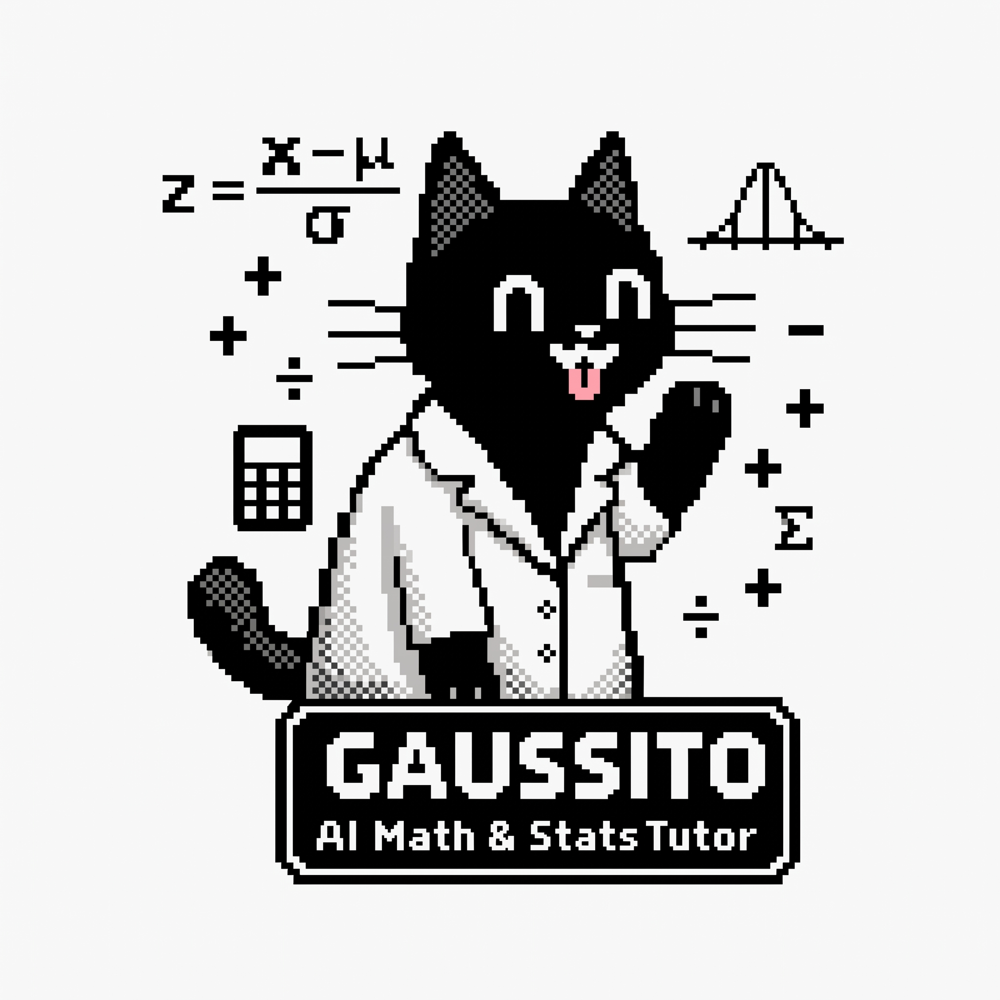
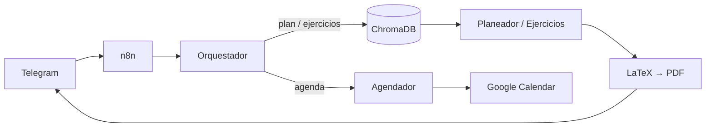

<p align="center">
  
</p>

# agente-tutor

**Gaussito** es un bot de Telegram que me ayuda a preparar tutorías de matemáticas y estadística. Arma planes de clase y talleres en PDF a partir de mis guías, soluciones de ejercicios y libros, y agenda las clases en Google Calendar.

Stack: n8n, Ollama (`qwen3:14b`, `bge-m3`), ChromaDB y LaTeX (Tectonic).



Requisitos: Docker, [Ollama](https://ollama.com), [uv](https://docs.astral.sh/uv/) y una GPU que soporte `qwen3:14b` (probado en una RTX 5070).

```bash
cp .env.example .env
ollama pull qwen3:14b && ollama pull bge-m3
docker compose up -d --build
uv sync
TUTORIAS_DIR=/ruta/a/tutorias uv run python -m rag.ingestar
```

Luego importa `n8n/agente-tutor.json` en http://localhost:5678 y conecta Telegram y Google Calendar.

Para medir la búsqueda, `uv run python -m rag.evaluar` calcula hit@5 y MRR@5 sobre 25 preguntas de `rag/preguntas.yaml`.
